# Design Document: Multilingual Mandi Platform

## Overview

The Multilingual Mandi platform is a progressive web application (PWA) that leverages AI technologies to eliminate language barriers and improve price transparency in Indian agricultural markets. The system integrates real-time translation, voice processing, price intelligence, and negotiation assistance into a mobile-first interface optimized for low-end smartphones and 2G networks.

The platform addresses three core challenges: language barriers between traders from different regions, lack of transparent pricing information, and inefficient negotiation processes. By combining modern AI capabilities with culturally appropriate design, the system empowers small-scale vendors, farmers, and buyers to participate more effectively in local mandi ecosystems.

## Architecture

### High-Level Architecture

```mermaid
graph TB
    subgraph "Client Layer"
        PWA[Progressive Web App]
        Voice[Voice Interface]
        UI[Responsive UI]
    end
    
    subgraph "API Gateway"
        Gateway[API Gateway/Load Balancer]
    end
    
    subgraph "Core Services"
        Translation[Translation Service]
        Voice_Processing[Voice Processing Service]
        Price_Intelligence[Price Intelligence Service]
        Negotiation[Negotiation Assistant Service]
        User_Management[User Management Service]
        Commodity_Processing[Commodity Processing Service]
        Market_Insights[Market Insights Service]
        Communication[Real-Time Communication Service]
    end
    
    subgraph "AI/ML Layer"
        Translation_Model[Multilingual Translation Models]
        STT[Speech-to-Text Models]
        TTS[Text-to-Speech Models]
        Price_ML[Price Prediction Models]
        NLG[Natural Language Generation]
    end
    
    subgraph "Data Layer"
        User_DB[(User Database)]
        Market_DB[(Market Data)]
        Translation_Cache[(Translation Cache)]
        Voice_Cache[(Voice Cache)]
    end
    
    subgraph "External APIs"
        Market_APIs[Market Data APIs]
        Weather_APIs[Weather APIs]
        Government_APIs[Government Price APIs]
    end
    
    PWA --> Gateway
    Voice --> Gateway
    UI --> Gateway
    
    Gateway --> Translation
    Gateway --> Voice_Processing
    Gateway --> Price_Intelligence
    Gateway --> Negotiation
    Gateway --> User_Management
    Gateway --> Commodity_Processing
    Gateway --> Market_Insights
    Gateway --> Communication
    
    Translation --> Translation_Model
    Voice_Processing --> STT
    Voice_Processing --> TTS
    Price_Intelligence --> Price_ML
    Negotiation --> NLG
    Market_Insights --> Price_ML
    Communication --> Translation_Model
    
    Translation --> Translation_Cache
    Voice_Processing --> Voice_Cache
    User_Management --> User_DB
    Price_Intelligence --> Market_DB
    Commodity_Processing --> Market_DB
    Market_Insights --> Market_DB
    Communication --> User_DB
    
    Price_Intelligence --> Market_APIs
    Price_Intelligence --> Weather_APIs
    Price_Intelligence --> Government_APIs
    Market_Insights --> Market_APIs
    Market_Insights --> Government_APIs
```



### Technology Stack

**Frontend:**
- Progressive Web App (PWA) with Service Workers for offline capability
- Vanilla JavaScript with Web Components for lightweight performance
- CSS Grid and Flexbox for responsive design
- Web Speech API for browser-native voice processing
- IndexedDB for local data storage and caching

**Backend:**
- Node.js with Express.js for API services
- Redis for caching and session management
- PostgreSQL for persistent data storage
- Docker containers for service deployment
- Nginx for load balancing and static file serving

**AI/ML Services:**
- Hugging Face Transformers for multilingual translation models
- OpenAI Whisper or Vakyansh models for Indian language speech recognition
- Festival or eSpeak-ng for text-to-speech synthesis
- TensorFlow/PyTorch for price prediction models
- OpenAI GPT or local LLM for negotiation assistance

## Components and Interfaces

### Translation Service

**Purpose:** Provides real-time bidirectional translation between supported Indian languages.

**Key Features:**
- Support for 7 Indian languages plus English
- Context-aware translation maintaining cultural nuances
- Caching for common phrases and commodity terms
- Fallback mechanisms for translation failures

**Interface:**
```javascript
class TranslationService {
  async translateText(text, fromLang, toLang, context = null)
  async translateBatch(textArray, fromLang, toLang)
  async detectLanguage(text)
  getCachedTranslation(text, fromLang, toLang)
  setCachedTranslation(text, fromLang, toLang, translation)
}
```

**Implementation Approach:**
Based on research findings, the service will use fine-tuned models like Sarvam-Translate or IndicBERT that specifically support Indian languages. The system will implement a hybrid approach combining pre-trained models with domain-specific fine-tuning on agricultural and trading terminology.

### Voice Processing Service

**Purpose:** Handles speech-to-text and text-to-speech conversion for voice-first interactions.

**Key Features:**
- Speech recognition for Indian languages with noise filtering
- Natural-sounding text-to-speech synthesis
- Audio compression for 2G network optimization
- Voice activity detection and silence handling

**Interface:**
```javascript
class VoiceProcessingService {
  async speechToText(audioBlob, language)
  async textToSpeech(text, language, voiceProfile = 'default')
  async detectSpeechLanguage(audioBlob)
  compressAudio(audioBlob, quality = 'medium')
  validateAudioQuality(audioBlob)
}
```

**Implementation Approach:**
The service will leverage Vakyansh models for Indian language speech recognition, as identified in research. For text-to-speech, it will use lightweight synthesis engines optimized for mobile devices, with audio compression to minimize bandwidth usage on 2G networks.

### Price Intelligence Service

**Purpose:** Analyzes market data and provides intelligent price suggestions and market insights.

**Key Features:**
- Real-time price range suggestions based on multiple factors
- Market trend analysis and forecasting
- Regional price variation detection
- Seasonal and weather impact consideration

**Interface:**
```javascript
class PriceIntelligenceService {
  async getPriceRange(commodity, location, quantity, quality)
  async getMarketTrends(commodity, region, timeframe)
  async getDailyInsights(userLocation, userRole)
  async predictPriceMovement(commodity, timeframe)
  updateMarketData(source, data)
}
```

**Implementation Approach:**
Based on research showing 91% accuracy with hybrid LSTM+XGBoost systems, the service will implement ensemble models combining time series analysis with external factors like weather, seasonal patterns, and government policy changes. Data sources will include government APIs, market data feeds, and historical price databases.

### Negotiation Assistant Service

**Purpose:** Generates culturally appropriate negotiation phrases and suggestions.

**Key Features:**
- Context-aware phrase generation
- Cultural tone adaptation based on user roles
- Fairness validation to prevent exploitative suggestions
- Multi-turn conversation support

**Interface:**
```javascript
class NegotiationAssistantService {
  async generateNegotiationPhrase(context, userRole, targetLang, tone)
  async validateFairness(offer, marketPrice, commodity)
  async suggestCounterOffer(currentOffer, marketRange, strategy)
  async adaptCulturalTone(phrase, region, relationship)
}
```

**Implementation Approach:**
The service will use fine-tuned language models trained on Indian cultural communication patterns, with rule-based validation to ensure fairness and appropriateness. Templates will be culturally adapted for different regions and relationship dynamics.

### User Management Service

**Purpose:** Handles user authentication, preferences, and session management.

**Key Features:**
- Lightweight user profiles with language and role preferences
- Session persistence across devices
- Offline capability with local storage sync
- Privacy-focused data handling

**Interface:**
```javascript
class UserManagementService {
  async createUserProfile(language, role, location)
  async updatePreferences(userId, preferences)
  async getUserSession(sessionId)
  async syncOfflineData(userId, localData)
  validateUserRole(userId, requiredRole)
  validateLanguageSupport(language)
}
```

**Implementation Approach:**
The service implements a lightweight profile system optimized for mobile devices with limited storage. User preferences are stored locally using IndexedDB for offline access, with periodic synchronization to the server when connectivity is available. The onboarding flow ensures language selection occurs before any other interaction, followed by role selection as specified in Requirements 7.1 and 7.2.

### Commodity Processing Service

**Purpose:** Handles commodity input, validation, and information extraction.

**Key Features:**
- Multi-modal input support (voice and text)
- Information extraction for type, quantity, quality, location
- Validation against agricultural products database
- Regional naming convention support

**Interface:**
```javascript
class CommodityProcessingService {
  async processCommodityInput(input, inputType, language)
  async extractCommodityDetails(rawInput)
  async validateCommodity(commodityData)
  async handleIncompleteData(partialData, userLanguage)
  async resolveRegionalNames(commodityName, region)
}
```

**Implementation Approach:**
The service uses natural language processing to extract key commodity information from user input, supporting both voice and text modalities. It maintains a comprehensive database of agricultural products with multilingual names and regional variations to ensure accurate commodity identification across different Indian markets.

### Market Insights Service

**Purpose:** Generates daily market insights and trading recommendations.

**Key Features:**
- Daily price trend analysis and visualization
- High-demand commodity detection with visual indicators
- AI-generated trading strategy tips
- Multilingual insights presentation

**Interface:**
```javascript
class MarketInsightsService {
  async generateDailyInsights(userLocation, userRole, language)
  async detectMarketChanges(region, timeframe)
  async generateTradingTips(userRole, marketConditions, language)
  async visualizeMarketTrends(commodities, region)
  scheduleInsightsUpdate(time = '06:00')
}
```

**Implementation Approach:**
The service analyzes market data patterns to identify trends and generate actionable insights for different user roles. It uses machine learning algorithms to detect significant market changes and provides personalized recommendations based on user location and trading role. All insights are generated in the user's preferred language and updated daily at 6 AM local time as specified in Requirement 5.5.

### Real-Time Communication Service

**Purpose:** Facilitates real-time communication between users with translation and moderation.

**Key Features:**
- Real-time translation between user preferred languages
- Conversation context maintenance for translation accuracy
- Communication moderation and fairness detection
- Alternative phrasing suggestions and mediation

**Interface:**
```javascript
class CommunicationService {
  async createCommunicationSession(vendorId, buyerId, commodity)
  async translateMessage(message, fromLang, toLang, context)
  async moderateMessage(message, sessionContext)
  async suggestAlternativePhrasing(message, intent, targetLang)
  async logSuccessfulNegotiation(sessionId, outcome)
  async detectUnfairCommunication(message, marketContext)
}
```

**Implementation Approach:**
The service manages real-time communication sessions between vendors and buyers, providing seamless translation while maintaining conversation context for improved accuracy. It implements AI-powered moderation to detect potentially unfair or exploitative communication attempts and suggests alternative phrasing when communication breaks down, as specified in Requirements 9.3 and 9.4.

## Data Models

### User Profile
```javascript
{
  userId: string,
  preferredLanguage: string, // ISO code
  role: 'vendor' | 'buyer' | 'farmer' | 'trader',
  location: {
    state: string,
    district: string,
    market: string
  },
  preferences: {
    voiceEnabled: boolean,
    negotiationStyle: 'polite' | 'assertive' | 'balanced',
    priceAlerts: boolean
  },
  createdAt: timestamp,
  lastActive: timestamp
}
```

### Commodity
```javascript
{
  commodityId: string,
  name: {
    en: string,
    hi: string,
    te: string,
    ta: string,
    kn: string,
    bn: string,
    mr: string
  },
  category: string,
  unit: string,
  qualityGrades: string[],
  seasonality: {
    peakMonths: number[],
    offSeasonMonths: number[]
  },
  regionalNames: object
}
```

### Price Data
```javascript
{
  priceId: string,
  commodityId: string,
  location: {
    state: string,
    district: string,
    market: string
  },
  priceRange: {
    min: number,
    max: number,
    modal: number
  },
  quality: string,
  quantity: number,
  unit: string,
  timestamp: timestamp,
  source: string,
  confidence: number
}
```

### Translation Cache
```javascript
{
  cacheId: string,
  sourceText: string,
  sourceLang: string,
  targetLang: string,
  translation: string,
  context: string,
  confidence: number,
  createdAt: timestamp,
  accessCount: number
}
```

### Negotiation Context
```javascript
{
  sessionId: string,
  participants: {
    vendor: {
      userId: string,
      language: string,
      role: string
    },
    buyer: {
      userId: string,
      language: string,
      role: string
    }
  },
  commodity: {
    commodityId: string,
    quantity: number,
    quality: string
  },
  currentOffer: number,
  marketRange: {
    min: number,
    max: number
  },
  conversationHistory: array,
  status: 'active' | 'completed' | 'abandoned',
  createdAt: timestamp
}
```

### Communication Session
```javascript
{
  sessionId: string,
  participants: {
    vendor: {
      userId: string,
      language: string,
      preferredName: string
    },
    buyer: {
      userId: string,
      language: string,
      preferredName: string
    }
  },
  messages: [{
    messageId: string,
    senderId: string,
    originalText: string,
    originalLanguage: string,
    translations: {
      [languageCode]: string
    },
    timestamp: timestamp,
    moderationFlags: string[]
  }],
  commodity: {
    commodityId: string,
    quantity: number,
    quality: string,
    agreedPrice: number
  },
  status: 'active' | 'completed' | 'abandoned' | 'moderated',
  createdAt: timestamp,
  lastActivity: timestamp
}
```

## Correctness Properties

The following properties define the correctness criteria that must be validated through property-based testing to ensure the system meets all requirements:

### Property 1: Language Support Validation
**Validates: Requirements 1.1, 7.5**
- For any language selection input, the system SHALL accept only the supported languages (Hindi, Telugu, Tamil, Kannada, Bengali, Marathi, English) and reject all others with appropriate error messages.

### Property 2: Translation Performance and Accuracy
**Validates: Requirements 1.2, 1.5**
- For any valid text input in a supported language, translation to any other supported language SHALL complete within 3 seconds and maintain bidirectional capability.

### Property 3: Translation Error Handling
**Validates: Requirements 1.4**
- For any translation failure scenario, the system SHALL activate fallback mechanisms and provide error notifications to users.

### Property 4: Voice Recognition Accuracy
**Validates: Requirements 2.1, 2.5**
- For any clear speech input in supported languages, the speech-to-text system SHALL achieve at least 85% accuracy while filtering background noise.

### Property 5: Voice Interaction Completeness
**Validates: Requirements 2.3, 2.4**
- For any voice interaction, the system SHALL provide audio feedback for major actions and request clarification for unclear input through audio prompts.

### Property 6: Price Range Generation
**Validates: Requirements 3.1, 3.5**
- For any valid commodity specification, the system SHALL provide price ranges (not single values) based on current market data within the specified update intervals.

### Property 7: Price Intelligence Factors
**Validates: Requirements 3.2, 3.4**
- For any price calculation, the system SHALL consider local market trends, regional demand, seasonal factors, and indicate uncertainty when data is insufficient.

### Property 8: Price Data Freshness
**Validates: Requirements 3.3, 5.5**
- For any price data request, the system SHALL ensure data is updated every 4 hours and market insights are refreshed daily at 6 AM local time.

### Property 9: Negotiation Assistant Role Adaptation
**Validates: Requirements 4.2, 4.5**
- For any negotiation assistance request, the system SHALL adapt tone based on user role (vendor/buyer) and provide both aggressive and polite options.

### Property 10: Negotiation Fairness Validation
**Validates: Requirements 4.3**
- For any negotiation suggestion, the system SHALL prevent generation of unfair or exploitative pricing recommendations through validation against market ranges.

### Property 11: Negotiation Language Localization
**Validates: Requirements 4.1**
- For any negotiation phrase generation, the system SHALL produce culturally appropriate phrases in the user's specified language.

### Property 12: Market Insights Localization
**Validates: Requirements 5.1, 5.4**
- For any market insights display, the system SHALL present daily price trends and information in the user's preferred language for their region.

### Property 13: Market Change Detection
**Validates: Requirements 5.2, 5.3**
- For any significant market condition change, the system SHALL highlight high-demand commodities with visual indicators and provide AI-generated strategy tips.

### Property 14: UI Accessibility Standards
**Validates: Requirements 6.1, 6.5**
- For any UI element, the system SHALL maintain minimum 44px touch targets and consistent navigation patterns throughout all screens.

### Property 15: Performance Under Constraints
**Validates: Requirements 6.4, 10.1, 10.2**
- For any device with limited resources or 2G network, the system SHALL load within 10 seconds and maintain core functionality without crashes.

### Property 16: Responsive Design Adaptation
**Validates: Requirements 10.3**
- For any screen size from 320px to 1920px width, the system SHALL adapt layout automatically while maintaining functionality.

### Property 17: User Preference Persistence
**Validates: Requirements 7.3, 7.4**
- For any user preference setting, the system SHALL remember choices across sessions using local storage and provide easy access for modifications.

### Property 18: Onboarding Flow Sequence
**Validates: Requirements 7.1, 7.2**
- For any new user, the system SHALL prompt for language selection before any other interaction, followed by role selection (Vendor, Buyer, Farmer, Trader).

### Property 19: Commodity Input Processing
**Validates: Requirements 8.1, 8.2, 8.3**
- For any commodity input (voice or text), the system SHALL extract key information (type, quantity, quality, location) and validate against the agricultural products database.

### Property 20: Incomplete Data Handling
**Validates: Requirements 8.4, 8.5**
- For any incomplete commodity information, the system SHALL prompt for missing details through guided questions and support regional naming conventions.

### Property 21: Real-time Communication Translation
**Validates: Requirements 9.1, 9.2**
- For any communication between users, the system SHALL provide real-time translation between preferred languages while maintaining conversation context.

### Property 22: Communication Moderation and Assistance
**Validates: Requirements 9.3, 9.4, 9.5**
- For any user communication, the system SHALL detect unfair attempts, suggest alternative phrasing when needed, and log successful negotiations.

### Property 23: Offline Capability and Data Optimization
**Validates: Requirements 10.4, 10.5**
- For any poor network condition, the system SHALL provide offline capabilities for basic functions and minimize data usage through optimized caching.

## Performance Requirements

### Response Time Requirements
- **Translation Service**: Maximum 3 seconds for any translation request (Requirement 1.2)
- **Voice Processing**: Real-time speech-to-text with maximum 2-second delay (Requirement 2.1)
- **Price Intelligence**: Maximum 5 seconds for price range calculations (Requirement 3.1)
- **Page Load**: Maximum 10 seconds on 2G networks (Requirement 10.1)

### Accuracy Requirements
- **Voice Recognition**: Minimum 85% accuracy for supported languages (Requirement 2.1)
- **Translation Quality**: Maintain cultural context and meaning preservation (Requirement 1.3)
- **Price Predictions**: Based on research showing 91% accuracy with LSTM+XGBoost models (Requirement 3.2)

### Availability Requirements
- **Data Updates**: Price data refreshed every 4 hours (Requirement 3.3)
- **Market Insights**: Daily updates at 6 AM local time (Requirement 5.5)
- **Offline Capability**: Basic functions available without network connectivity (Requirement 10.4)

### Scalability Requirements
- **Concurrent Users**: Support for multiple simultaneous translation and negotiation sessions
- **Data Storage**: Efficient caching strategies to minimize bandwidth usage (Requirement 10.5)
- **Device Compatibility**: Function on low-end smartphones with limited RAM (Requirement 10.2)

## Security and Privacy Considerations

### Data Protection
- **User Privacy**: Minimal data collection focused only on essential functionality
- **Local Storage**: Sensitive preferences stored locally rather than on servers when possible
- **Session Management**: Secure session handling with appropriate timeout mechanisms

### AI Model Security
- **Translation Models**: Use of established, validated models (Sarvam-Translate, IndicBERT)
- **Fairness Validation**: Rule-based systems to prevent exploitative suggestions (Requirement 4.3)
- **Content Moderation**: Detection and flagging of inappropriate communication (Requirement 9.3)

### Network Security
- **API Security**: Secure communication between client and services
- **Data Transmission**: Encrypted data transfer for sensitive information
- **Offline Security**: Secure local data storage and synchronization

## Implementation Considerations

### Mobile-First Design Decisions
**Rationale**: Given the target audience of mandi users with low-end smartphones and 2G connectivity, the platform prioritizes mobile performance over desktop features.

**Key Decisions**:
- Progressive Web App architecture for offline capability (Requirements 10.4, 6.4)
- Vanilla JavaScript over heavy frameworks for performance (Requirement 10.2)
- Audio compression and efficient caching for 2G networks (Requirements 2.5, 10.5)
- 44px minimum touch targets for accessibility (Requirement 6.1)

### AI Model Selection Rationale
**Translation Models**: Selection of Sarvam-Translate and IndicBERT based on their specific optimization for Indian languages and cultural context preservation (Requirements 1.1, 1.3).

**Voice Processing**: Vakyansh models chosen for their superior performance with Indian language speech recognition and noise filtering capabilities (Requirements 2.1, 2.5).

**Price Intelligence**: LSTM+XGBoost ensemble approach selected based on research showing 91% accuracy for agricultural price prediction with seasonal and weather factor integration (Requirements 3.2, 3.4).

### Cultural Adaptation Strategy
**Design Philosophy**: The platform incorporates Indian cultural elements throughout the user experience to ensure familiarity and trust among mandi users.

**Implementation**:
- Indian color palette and culturally familiar icons (Requirement 6.2)
- Regional commodity naming conventions support (Requirement 8.5)
- Culturally appropriate negotiation phrase generation (Requirements 4.1, 4.4)
- Respect level adaptation based on user relationships (Requirement 4.4)

### Offline-First Architecture
**Rationale**: Given the unreliable network connectivity in many mandi locations, the platform is designed to function primarily offline with periodic synchronization.

**Key Features**:
- IndexedDB for local data storage and caching (Requirement 10.4)
- Service Workers for offline capability (Requirement 10.4)
- Progressive loading of essential features (Requirement 10.1)
- Data synchronization when connectivity returns (Requirements 7.3, 10.4)